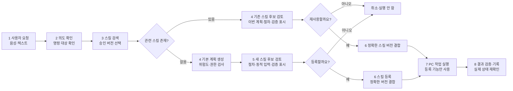

# SKILLA 실제 구현·모델·실험 확인표

이 문서는 발표 자료와 포스터에 넣을 내용을 실제 코드, 설정 파일, 실행 기록과 대조하기 위한
기준 문서다. 계획 중인 기능과 구현된 기능을 섞지 않는다.

## 1. 프로그램 한 줄 설명

SKILLA는 사용자가 Windows에서 반복하는 작업의 **절차, 판단 기준, 완료 확인 방법**을
스킬로 저장하고, 다음 요청에서 현재 파일·폴더 상태에 맞춰 다시 실행하는 로컬 PC 작업
에이전트다.

## 2. 현재 실제 구현 범위

- 음성 또는 텍스트 요청 입력
- 요청 의도 분류와 실행 계획 생성
- 승인된 스킬 검색과 버전 선택
- 등록된 Windows 기능만을 통한 작업 실행
- 실행기와 분리된 완료 조건 검사
- 성공·실패, 시간, 언어 모델 호출 수, 토큰, 사용자 확인 횟수 기록
- 실행 기록을 바탕으로 최초 스킬 또는 개정 스킬 초안 생성
- 사용자가 초안을 승인하기 전에는 실행 스킬로 사용하지 않는 검토 절차
- 완결된 신규 계획의 사전 안전 확인 → 후보 검토 → 동의 시 등록·실행
- 기존 스킬의 이번 실행 계획 검토, 음성·텍스트·화면 버튼 응답
- 대기, 계획, 후보 검토, 실행, 종료, 스킬 관리, 실행 기록 검토, 검증 결과 화면

새 후보의 승인 상태는 사용자 검토 여부를 뜻하며 첫 실행 성공을 뜻하지 않는다
관찰 결과에 따라 후속 계획을 생성하는 작업의 등록·재사용 연결은 추가 검증 중이다
실제 사용자 음성 표본으로 음성 인식 → 기존 스킬 검색 → 재사용 승인 → 실행 → 독립 결과 검사를
연결해 확인했다. 다만 여러 화자·소음 환경을 포함한 음성 정확도 평가는 아직 완료하지 않았다

## 3. 실제 사용 모델과 구성

| 구분 | 현재 구현 | 역할 | 확인 위치 |
|---|---|---|---|
| 언어 모델(LLM) | NVIDIA NIM의 `z-ai/glm-5.3-flash` | 요청 의도 분류, 기본 계획 생성, 사용자가 요청한 스킬 초안 작성 | `config/product_host.json`, `src/skilla_core/product_composition.py` |
| 음성 인식(STT) | Whisper large-v3-turbo / `dropbox-dash/faster-whisper-large-v3-turbo` | 한국어 음성을 텍스트 명령으로 변환, 현재 CPU int8 실행 | `models/faster-whisper-large-v3-turbo/manifest.json` |
| 음성 출력(TTS) | Supertonic 3 int8 / sherpa-onnx CPU | 고정 상태 안내 문장을 로컬 음성으로 생성. 소스와 배포된 EXE에서 WAV 생성 확인, 자연스러움 청취 평가는 미실시 | `src/skilla_core/supertonic_tts.py`, `docs/TTS.md` |
| 음성 출력 예비 경로 | Windows SAPI | 기본 음성 엔진 실패 시 로컬 안내 | `src/skilla_core/product_service.py` |

용어 설명:

- LLM(대규모 언어 모델): 사용자의 문장을 이해하고 작업 순서를 만드는 모델
- STT(Speech to Text, 음성 문자 변환): 마이크 음성을 글자로 바꾸는 기능
- TTS(Text to Speech, 문자 음성 변환): 글자를 음성으로 읽는 기능
- NIM: NVIDIA가 제공하는 모델 호출용 실행 서비스

## 3-1. 명칭 전환 범위

- 제품명, 실행 파일, 패키지, 문서, 생성 도구와 사용자 화면은 `SKILLA`로 통일
- 과거 설치 데이터를 새 위치로 옮기기 위한 호환 식별자만 `JAVIS-PC` 이름으로 읽기 지원
- `models/openwakeword/hey_jarvis_v0.1.onnx`는 공개 openWakeWord 원본 모델의 공식 파일명이라
  이름을 바꾸지 않고 비교·참고용으로만 보존하며 현재 SKILLA 배포 묶음에서는 제외

## 4. 실제 실행 흐름

## 5. 재현 가능한 자체실험 환경

### 하드웨어·운영체제

- 운영체제: Microsoft Windows 11 Home, 버전 10.0.26300
- CPU: AMD Ryzen 5 9500F 6-Core Processor
- 메모리: 15.4 GB
- GPU: NVIDIA GeForce RTX 5060 Ti
- 실험 PC: 개발 PC 한 대

### 고정 조건

- 실행 묶음 식별자: `developer10`
- 조건 순서 난수 초기값(seed): `2026102001`
- 작업 5종 × 반복 3회 × 조건 4종 = 60개 관측
- 매 조건 실행 전 같은 초기 파일 묶음을 새 임시 폴더에 생성
- 네 조건의 초기 상태 SHA-256이 다르면 수집 거부
- 같은 블록에서 모델 ID, 모델 설정, 도구 목록을 동일하게 유지
- 실패, 계획 오류, 실행 예산 초과를 제외하지 않음
- 성공 여부는 언어 모델 답변이 아니라 별도 결과 검사기로 판정

### 비교 조건

- SK0: 스킬 없이 언어 모델과 Windows 기능만 사용
- SK1: 같은 반복 절차를 일반 지침으로 제공
- SK2: 절차·동적 입력·판단 규칙·검증 규칙을 포함한 최초 스킬 사용
- SK3: 이전 실패를 반영해 개정한 스킬 사용

## 6. 평가 기준과 계산

- 작업 성공률 = 독립 결과 검사를 통과한 실행 수 ÷ 전체 실행 수
- 실행 시간 = 요청 처리 시작부터 결과 검사 완료까지의 시간
- 언어 모델 호출 수 = 한 작업에서 LLM을 호출한 횟수
- 토큰 사용량 = LLM 입력 토큰과 출력 토큰의 합
- 사용자 확인 횟수 = 실행 중 사용자가 추가로 확인하거나 승인한 횟수
- 성공률 불확실성: Wilson 방식 95% 신뢰구간
- 대응 성공 여부 비교: 정확 McNemar 검정
- 세 번의 비교 보정: Holm 방법

Wilson, McNemar, Holm은 프로그램의 성능을 만드는 방법이 아니라, 관측된 차이가 우연인지
검토하기 위한 통계 방법이다. 성공률·시간·호출 수·토큰은 프로그램 동작을 직접 설명하는
평가지표이고, 통계 검정은 해석을 과장하지 않기 위한 보조 수단이다.

## 7. 최신 확인 실험 결과

| 조건 | 성공 | 평균 시간 | 평균 LLM 호출 | 평균 토큰 | 평균 사용자 확인 |
|---|---:|---:|---:|---:|---:|
| SK0 | 10/15 | 18.783초 | 2.200 | 3,759.5 | 0.333 |
| SK1 | 12/15 | 18.614초 | 2.467 | 4,268.9 | 0.600 |
| SK2 | 12/15 | 25.742초 | 3.000 | 5,680.9 | 0.533 |
| SK3 | 14/15 | 12.367초 | 1.867 | 3,135.7 | 1.000 |

SK3는 SK0과 비교해 평균 실행 시간이 34.2%, 평균 토큰이 16.6% 적었다. 그러나 15개 블록의
소규모 자체실험이며 Holm 보정 뒤 성공률 차이는 통계적으로 유의하지 않았다. 따라서
“모든 환경에서 성능이 향상된다”가 아니라 “이 개발 PC의 확인 실험에서 복잡한 파일 정리 작업을
중심으로 개선 가능성이 관측되었다”라고 설명해야 한다.

## 8. 발표에서 구분할 내용

- 구현됨: 위 2절의 기능과 3절의 모델 구성
- 확인됨: 5~7절의 자체실험과 무결성 검사 결과
- 확인되지 않음: 일반 사용자 전체에 대한 효과, 모든 Windows PC에서 같은 성능, 완전 자동화
- 후속 검증 필요: 익명 참가자 실험, 더 많은 PC 환경, 더 큰 표본, 장기 사용 자료

실험 원문과 해시는 `docs/SKILL_STUDY_CONFIRMATION_RESULTS_20261020.md`에서 확인한다.

## 9. 2026-11-06 제품 빌드 확인

- 전체 자동 테스트: 끝까지 통과, 환경 의존 시험 5개 건너뜀
- 정적 검사: 현재 실행 코드, 테스트, 새 모델 준비·패키징 도구 통과
- 최신 장치 보정·반응형 UI·음성 복구 배포 폴더: `dist/SKILLA-PC-0.1.9-release-r15`
- 패키지 무결성: 1,868개 파일, `VERIFIED`
- 배포판 Doctor: 필수 항목 전체 통과, 개발용 .NET SDK만 선택 경고
- 배포판 서비스 조립: 13개 기능, `ready=true`, 마이크 미개방 상태 확인
- 배포 폴더 이름 변경: 프로젝트 밖 임시 경로에서 실제 실행과 무결성·Doctor 검사 통과 후 임시 폴더 제거
- 배포판 Supertonic 3: 367,770바이트 한국어 WAV 실제 생성 후 시험 파일 제거·재검증
- 배포 모델: Whisper large-v3-turbo와 Supertonic 3만 포함, 사용하지 않는 과거 영어 호출어 모델 제외
- 오인식 방지: 낮은 Whisper 구간 신뢰도·높은 무음 확률 차단, 등록하지 않은 유사 호출어 거부
- 실제 마이크 확인: 장치 1 Realtek에서 10초 실제 발화 녹음, 호출 문장 두 번 정확히 전사
- 실시간 UI 확인: 음성 입력 감지와 호출 문장 표시, REACTOR STATUS의 `MIC n%` 실시간 변화 확인
- 실시간 보정: VAD 500→80, 대기열 32→256프레임으로 변경하여 낮은 입력 감도와 CPU STT 지연 대응
- 자기음성 차단: TTS 재생 중 입력 프레임과 재생 종료 뒤 0.64초 잔향을 STT 명령에서 제외
- 마이크 자동 복구: 일시적 입력 장치 상태 오류로 캡처가 끝나면 최대 5회 자동 재시작
- 새 스킬 실제 흐름: 21.281초에 REGISTER 후보 표시, 승인·등록·실행 뒤 34.047초에 독립 검증 완료
- 기존 스킬 실제 흐름: 0.25초에 REUSE 후보 표시, 승인·실행 뒤 10.766초에 독립 검증 완료
- 실제 음성 UI: Realtek 발화로 저장 스킬 후보 검토 화면까지 표시, 미응답 시 자동 취소 확인
- 실제 음성 승인: 녹음된 사용자 `예.`를 large-v3-turbo가 전사하고 기존 스킬 검토 응답으로
  수락, 1개 동작 실행과 독립 검증 완료
- 음성 승인 근거: `evaluation/voice_review_flow_validation_20261106.json`
- 실제 사용자 음성 4개 확인: 명령 반복 2개, 실시간 명령 1개, 후보 승인 1개를 모두 의도대로 전사
  (`evaluation/stt_user_audio_validation_20261107.json`)
- 전체 회귀 테스트: 전부 통과, 환경 의존 시험 5개 건너뜀
- 실제 결과 근거: `output/voice_skill_end_to_end_20261105.json`
- 이름·경로 변경 근거: `output/skilla_rename_relocation_audit_20261105.json`
- 남은 사용자 참여 확인: 여러 거리·소음·발음의 반복 인식률, 실제 스피커 청취 평가
