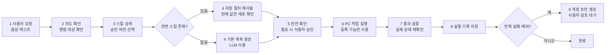

# SKILLA 실제 구현·모델·실험 확인표

이 문서는 발표 자료와 포스터에 넣을 내용을 실제 코드, 설정 파일, 실행 기록과 대조하기 위한
기준 문서다. 계획 중인 기능과 구현된 기능을 섞지 않는다.

## 1. 프로그램 한 줄 설명

SKILLA는 사용자가 Windows에서 반복하는 작업의 **절차, 판단 기준, 완료 확인 방법**을
스킬로 저장하고, 다음 요청에서 현재 파일·폴더 상태에 맞춰 다시 실행하는 로컬 PC 작업
에이전트다.

## 2. 현재 실제 구현 범위

- 음성 또는 텍스트 요청 입력
- 요청 의도 분류와 실행 계획 생성
- 승인된 스킬 검색과 버전 선택
- 등록된 Windows 기능만을 통한 작업 실행
- 실행기와 분리된 완료 조건 검사
- 성공·실패, 시간, 언어 모델 호출 수, 토큰, 사용자 확인 횟수 기록
- 실행 기록을 바탕으로 최초 스킬 또는 개정 스킬 초안 생성
- 사용자가 초안을 승인하기 전에는 실행 스킬로 사용하지 않는 검토 절차
- 대기, 계획, 실행, 종료, 스킬 검토, 실행 기록 검토, 검증 결과 화면

## 3. 실제 사용 모델과 구성

| 구분 | 현재 구현 | 역할 | 확인 위치 |
|---|---|---|---|
| 언어 모델(LLM) | NVIDIA NIM의 `z-ai/glm-5.3-flash` | 요청 의도 분류, 기본 계획 생성, 사용자가 요청한 스킬 초안 작성 | `config/product_host.json`, `src/javis_core/product_composition.py` |
| 음성 인식(STT) | `Systran/faster-whisper-small` | 한국어 음성을 텍스트 명령으로 변환 | `models/faster-whisper-small/manifest.json` |
| 음성 출력(TTS) | Microsoft Edge Neural TTS `ko-KR-SunHiNeural` | 상태와 결과를 자연스러운 한국어 음성으로 안내 | `src/javis_core/natural_tts.py`, `docs/TTS.md` |
| 음성 출력 예비 경로 | Windows SAPI | 네트워크 음성 출력 실패 시 로컬 안내 | `src/javis_core/natural_tts.py` |

용어 설명:

- LLM(대규모 언어 모델): 사용자의 문장을 이해하고 작업 순서를 만드는 모델
- STT(Speech to Text, 음성 문자 변환): 마이크 음성을 글자로 바꾸는 기능
- TTS(Text to Speech, 문자 음성 변환): 글자를 음성으로 읽는 기능
- NIM: NVIDIA가 제공하는 모델 호출용 실행 서비스

## 4. 실제 실행 흐름

## 5. 재현 가능한 자체실험 환경

### 하드웨어·운영체제

- 운영체제: Microsoft Windows 11 Home, 버전 10.0.26300
- CPU: AMD Ryzen 5 9500F 6-Core Processor
- 메모리: 15.4 GB
- GPU: NVIDIA GeForce RTX 5060 Ti
- 실험 PC: 개발 PC 한 대

### 고정 조건

- 실행 묶음 식별자: `developer10`
- 조건 순서 난수 초기값(seed): `2026102001`
- 작업 5종 × 반복 3회 × 조건 4종 = 60개 관측
- 매 조건 실행 전 같은 초기 파일 묶음을 새 임시 폴더에 생성
- 네 조건의 초기 상태 SHA-256이 다르면 수집 거부
- 같은 블록에서 모델 ID, 모델 설정, 도구 목록을 동일하게 유지
- 실패, 계획 오류, 실행 예산 초과를 제외하지 않음
- 성공 여부는 언어 모델 답변이 아니라 별도 결과 검사기로 판정

### 비교 조건

- SK0: 스킬 없이 언어 모델과 Windows 기능만 사용
- SK1: 같은 반복 절차를 일반 지침으로 제공
- SK2: 절차·동적 입력·판단 규칙·검증 규칙을 포함한 최초 스킬 사용
- SK3: 이전 실패를 반영해 개정한 스킬 사용

## 6. 평가 기준과 계산

- 작업 성공률 = 독립 결과 검사를 통과한 실행 수 ÷ 전체 실행 수
- 실행 시간 = 요청 처리 시작부터 결과 검사 완료까지의 시간
- 언어 모델 호출 수 = 한 작업에서 LLM을 호출한 횟수
- 토큰 사용량 = LLM 입력 토큰과 출력 토큰의 합
- 사용자 확인 횟수 = 실행 중 사용자가 추가로 확인하거나 승인한 횟수
- 성공률 불확실성: Wilson 방식 95% 신뢰구간
- 대응 성공 여부 비교: 정확 McNemar 검정
- 세 번의 비교 보정: Holm 방법

Wilson, McNemar, Holm은 프로그램의 성능을 만드는 방법이 아니라, 관측된 차이가 우연인지
검토하기 위한 통계 방법이다. 성공률·시간·호출 수·토큰은 프로그램 동작을 직접 설명하는
평가지표이고, 통계 검정은 해석을 과장하지 않기 위한 보조 수단이다.

## 7. 최신 확인 실험 결과

| 조건 | 성공 | 평균 시간 | 평균 LLM 호출 | 평균 토큰 | 평균 사용자 확인 |
|---|---:|---:|---:|---:|---:|
| SK0 | 10/15 | 18.783초 | 2.200 | 3,759.5 | 0.333 |
| SK1 | 12/15 | 18.614초 | 2.467 | 4,268.9 | 0.600 |
| SK2 | 12/15 | 25.742초 | 3.000 | 5,680.9 | 0.533 |
| SK3 | 14/15 | 12.367초 | 1.867 | 3,135.7 | 1.000 |

SK3는 SK0과 비교해 평균 실행 시간이 34.2%, 평균 토큰이 16.6% 적었다. 그러나 15개 블록의
소규모 자체실험이며 Holm 보정 뒤 성공률 차이는 통계적으로 유의하지 않았다. 따라서
“모든 환경에서 성능이 향상된다”가 아니라 “이 개발 PC의 확인 실험에서 복잡한 파일 정리 작업을
중심으로 개선 가능성이 관측되었다”라고 설명해야 한다.

## 8. 발표에서 구분할 내용

- 구현됨: 위 2절의 기능과 3절의 모델 구성
- 확인됨: 5~7절의 자체실험과 무결성 검사 결과
- 확인되지 않음: 일반 사용자 전체에 대한 효과, 모든 Windows PC에서 같은 성능, 완전 자동화
- 후속 검증 필요: 익명 참가자 실험, 더 많은 PC 환경, 더 큰 표본, 장기 사용 자료

실험 원문과 해시는 `docs/SKILL_STUDY_CONFIRMATION_RESULTS_20261020.md`에서 확인한다.
